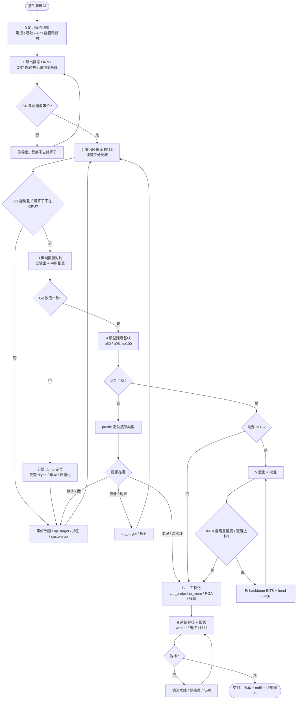
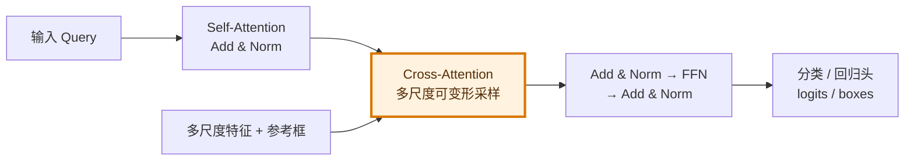
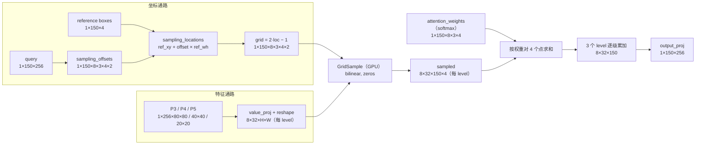
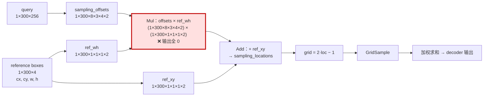

# RT-DETR 学习问题清单

> 记录阅读 `docs/porting-and-optimization.md` 及相关代码时提出的问题与结论。
> 状态：待回答 / 讨论中 / 已解决 / 待验证。详细命令见 `profiling-workflow.md`。

- 项目：rt-detr-rk3588-deploy（v4.1）
- 开始日期：2026-11-15

---

## 问题清单

| # | 问题 | 状态 |
|---|---|---|
| 1 | grid_sample 原来怎么处理？RKNN 2.5 之后又怎么处理？ | 已解决 |
| 2 | 三个 profile 方法是否科学？在 RKNN 上具体怎么落地？ | 已解决 |
| 3 | 流程为什么容易乱？每次改动都要全量 profile 吗？陌生模型怎么部署？ | 已解决 |
| 4 | ORT 验证的原理和过程是什么？ | 已解决 |
| 4.1 | 比的是参数还是输出？每层还是最终？余弦怎么用？ | 已解决 |
| 4.2 | 五个指标的含义和数学原理是什么？ | 已解决 |
| 5 | ORT 验证与混合精度量化有什么异同？ | 已解决 |
| 6 | transpose 算子为什么慢？v3 和 v4 分别怎么处理？ | 已解决 |
| 7 | 怎么判断计算受限、带宽受限还是开销受限？ | 已解决 |
| 8 | 6 维广播 Mul 为什么被编译成全 0？ | 已解决 |
| 9 | 逐元素乘（Mul）和矩阵乘（MatMul）有什么区别？ | 已解决 |

---

## 问题详情

### Q1. grid_sample 原来怎么处理？RKNN 2.5 之后怎么处理？

**本质区别：旧方案在“导出期”把算子消灭掉，新方案在“编译期”把算子指派到 GPU。**

旧（v2/v3，RKNN 2.3.x）：

- 2.3.x 的 runtime 没有 GridSample，CPU/NPU 都不支持；
- 做法是在 PyTorch 里 monkey-patch `F.grid_sample`，用 `floor / clamp / gather / mul / add`
  手写双线性采样，导出后 ONNX 里根本没有 GridSample 节点；
- 附带动机：规避 RKNN 对动态 shape / 布尔 mask 的 `dataconvert type -1` 报错；
- 代价：每个 level 展开 4 个 `(heads, C, Q×P)` 索引张量，Gather 是随机访问，
  NPU 不擅长；decoder ~255 ms，INT8 下索引/权重误差明显。

新（v4，RKNN 2.5.0）：

- 2.5.0 新增 GridSample，但只在 **GPU（OpenCL）** 后端实现，CPU/NPU 都没有；
- ONNX 保留单个节点，编译时 `--op-target-map 'GridSample=gpu'`，
  否则 auto 分到 CPU，运行时 `Unsupport CPU op: GridSample`；
- 运行时需要导出 `clImportMemoryARM` 的 OpenCL 库（Mali blob + shim）；
- 只接受 **FP16**，INT8 输入报 `std::out_of_range map::at`；
- 图的前后处理仍在 NPU，采样本身是 GPU 上的 3 次 kernel 调用。

**两个文档需修正的点：**

1. §3.4.2 伪代码写的是 `(W-1)/2`（align_corners=True），实际调用是
   `align_corners=False`，正确写法是 `((gx+1)*W - 1) / 2`，差半个像素；
2. v3 展开代码把索引 `clamp` 到边界，实现的是 **border padding**，而调用参数是
   `padding_mode='zeros'`；越界时取到了边缘像素而不是 0，严格说与 PyTorch 不等价。

### Q2. 三个 profile 方法是否科学？在 RKNN 上具体怎么落地？

**结论：分层方向对（组件 → 算子 → 设备），但三种方法单独都不足以做因果归属；
真正的因果证据来自改造前后的 A/B。**

| 方法 | 能回答 | 局限 |
|---|---|---|
| A 按前缀切子图 | 某一段的大致量级 | 子图是重新编译的模型，切点会插 I/O、丢融合，各段不可相加 |
| B 整模型 A/B 差值 | “做这个改动总时间变多少” | 差值 ≠ 算子成本，会混入设备边界/融合/布局 |
| C 官方分段 + 校准 | 数量级判断 | 跨构建、跨会话不可加，只能做三角验证 |

**三个缺口：** 单点数字没有离散度；速度对比没做因子设计（1.7× 混了量化与剪枝）；
逐层 profiler 崩了之后没有独立参照。

**RKNN 落地（六步）：**

1. **定口径**：`CLOCK_MONOTONIC_RAW` / `perf_counter_ns`；单配置 ≥100 次，
   对比 ≥3 轮；先跑 A/A 得噪声底，收益 > `max(3%, 3×噪声)` 才算数。
2. **固定环境**：CPU governor 与 devfreq 设 `performance`；记录温度与 NPU 负载；
   `taskset` 绑 A76；`RKNN_FLAG_COLLECT_PERF_MASK` 会降帧率，基准里禁用。
3. **系统级**：分段打点 + 队列水位 + 每帧 worker 时间线；`perf stat/record`
   找 CPU 热点，`strace -T -e ioctl` 量 `rknn_run`，`perf sched` 看唤醒。
4. **模型级**：官方接口是 `RKNN_FLAG_COLLECT_PERF_MASK` →
   `rknn_outputs_get` → `RKNN_QUERY_PERF_DETAIL`（逐层）/ `PERF_RUN`（微秒）。
   本图会 SIGSEGV，改用 `--decoder-layers 1/2/3` 拟合 `T(L)=aL+b`、
   `--num-queries 75/150/300` 拟合 `T(Q)=cQ+d`。
5. **干预级**：单变量、A/B/A/B 交替、同进程轮转；扩展 `bench_native.py`
   记录 manifest、频率、输出校验；配对差值取中位数。
6. **验证级**：数值 `max|d|` / 余弦 + 548 图 AP + ORT 算子排序与 RKNN 分段
   的方向对照；做成回归门禁。

**优先做两件：** A/A 噪声底；L/Q 两组构建。成本最低，能把现有推断值变成实测。

### Q3. 流程为什么容易乱？每次改动都要全量 profile 吗？

**根因：计划是线性的，现实是三个环。**

- **可行性**：算子能不能跑、在哪个设备、什么 dtype；
- **正确性**：导出等价、板端数值、AP；
- **性能**：模型延迟、系统吞吐。

任何改动都可能让另外两个环失效，所以要来回走。

**“profile”实际是四件事：** 定位（时间花在哪）、可行性（算子在哪）、
验证（算得对不对）、回归（改完有没有变好）。混用就会觉得做了很多遍却对不上。

**依赖链：** 图 → 设备与精度 → 单/拆架构 → C++ 数据通路 → 系统吞吐；
正确性在每个箭头后重过。

**为什么“只量化”到不了 1.7×：** 300q/3L 的 123 ms 里，可量化的
backbone+AIFI+neck 是 77 ms，decoder 46 ms 必须 FP16。即使前者快 4 倍，
总时间也只到约 65 ms（≈1.9× 上限）；实测同结构 1.32×。
首屏 1.7× 是量化 + 剪枝的合效果。

**Python 与 C++ 不是同一指标：** Python 是模型级下限（单进程、无流水线、
numpy 前后处理），C++ 是系统级（RGA、三级流水线、绑核）；只能比 `rknn_run`
段，整体差 17% 是预期。

**失效矩阵（改什么，重测什么）：**

| 改动 | 需要重跑 |
|---|---|
| 导出 / 改图 | G0–G5 |
| 编译参数（op_target 等） | G1–G5 |
| 量化 / 校准集 | G2–G4 |
| 预处理（RGA、letterbox） | G2、G3、G5、G6 |
| C++ 数据通路（io_mem、反量化） | G2、G5、G6 |
| 线程 / 队列 / 绑核 | G5、G6 |
| 评估脚本 / 阈值 | G3 |

**三级检查代替全量：**

| 级别 | 触发 | 内容 |
|---|---|---|
| L0 | 每次编译或改参 | 1–2 图全输出 `max\|d\|`、单帧 p50(25)、build id |
| L1 | 改模型 / 量化 / 预处理 | 50 图 AP、全输出数值、p50/p95(100) |
| L2 | 版本 / 里程碑 | 548 图 AP、2×2 矩阵、3/4 worker、30 min 长稳 |

**两条习惯：** 维护约束账本（版本 / 硬约束 / 放宽了什么 / 原因）；
补 300q/3L 的 INT8 拆分，才能把“量化”和“剪枝”的贡献分开。

---

### Q3 附：拿到一个陌生模型，怎么部署、怎么定位？

**总原则：先把“能不能跑”和“算得对不对”锁死，再谈快不快；
每次只改一层，改完回到最近的门。**



主干是：定目标 → 导出 → 可行性 → 正确性 → 模型性能 → 量化 → 工程 → 长稳；
每个菱形失败都回到“最便宜的一层”，不要一路推倒重来。

**四个手段的含义（代价从低到高）：**

- **op_target**：不改图，只改编译期的设备分配。例：
  `rknn.config(op_target={'GridSample': 'gpu', 'Mul': 'npu'})`，取值 `npu/cpu/gpu/auto`。
  用于“算子有实现但 auto 分错了”或“换个设备能绕开编译缺陷”。
  代价是设备边界（本项目 decoder 内一次边界约 9 ms/层）。
- **等价改图**：在导出期把算子/表达式换成数学等价、RKNN 友好的写法。
  例：v3 把 `grid_sample` 展开成 floor/clamp/gather；v4 把 6 维广播 Mul 改成 4 维；
  attention 逐 level 累加替代 stack。验证标准是 ORT 与原图 `max|d| = 0`，
  但**还要上板验证**——ONNX 等价不代表 RKNN 编译等价。
- **拆图**：在干净的张量边界把 ONNX 切成两个模型，分别编译（可各自不同 dtype/设备），
  运行时交接。例：`split_decoder.py` 把 backbone+neck 与 decoder 切开。
  用于单模型混合精度不可行时；代价是交接（反量化 + 布局）、双 context、配对校验。
- **custom op**：自己实现缺失算子并注册（`rknn_register_custom_ops`，CPU/GPU kernel）。
  控制力最强，但正确性、性能、跨版本兼容都要自己维护；注册失败整条链路不可用。
  本项目有 native GridSample，所以没有采用。

**选择顺序：** op_target → 等价改图 → 拆图 → custom op。
先试不改图的，再试不改运行时的，最后才自己写 kernel。

**阶段表：**

| 阶段 | 关键问题 | 方法 / 工具 | 通过标准 | 失败时 |
|---|---|---|---|---|
| 0 目标 | 优化什么？硬约束？ | 约束账本 | 指标可量化 | 先别动模型 |
| 1 导出 | 算子能被接受吗？ | ONNX 静态化、ORT、Netron、ORT profiling | 与源模型逐位等价 | 替换/重写算子 |
| 2 可行性 | 跑在哪？ | RKNN build log 分配表、`attr_probe` | 关键算子不在 CPU | 改图 / op_target / 拆图 |
| 3 正确性 | 数值对吗？ | dump 全输出/中间张量、`max\|d\|` | 达到阈值 | 分层定位 dtype/布局/反量化 |
| 4 模型性能 | 单帧多快？瓶颈？ | p50/p95、`PERF_DETAIL`、L/Q 构建 | 达到延迟目标 | 判断瓶颈类型 |
| 5 量化 | INT8 可行？ | 校准集 + build + 重跑 G2/G3 | 精度不掉、速度升 | 拆分或放弃 |
| 6 工程 | 系统吞吐？ | 三级流水线、绑核、队列水位、perf/strace | 达到吞吐目标 | 调流水线 |
| 7 交付 | 可复现？ | md5、build id、命令、长稳 | 回归通过 | 回退 |

**定位三问：**

1. 慢在整链路还是模型？→ 看分段 `pre / npu / post / wait`；
2. 慢在哪个算子？→ 算子分配表 + `PERF_DETAIL`；崩了用 L/Q 构建；
3. 慢在算力还是搬运？→ NPU 负载、CPU 算子数、设备切换次数、队列水位。

**常见瓶颈的对应动作：**

| 现象 | 判断 | 动作 |
|---|---|---|
| `wait_npu` 高、`npu` 低 | worker 饿死 | 加 pre 线程 / 调队列 |
| `npu` 高、NPU 负载低 | 驱动 / 带宽 | 减少设备切换、查内存布局 |
| CPU 算子多、切换多 | 边界成本 | 改图 / op_target / 拆分 |
| `pre` 高 | RGA 或 CPU 转换 | 换 RGA / 降分辨率 / 流水线化 |
| 4 worker 快于 3 worker | 有气泡 | 调线程与队列，不是算力 |

**陌生模型最常见的五个坑：**

1. 动态 shape / `-1` 维度 → 导出前静态化；
2. 不支持的算子（GridSample、TopK、NonZero）→ 等价重写或指定设备；
3. dtype / layout 假设错 → 先写 `attr_probe`，不要猜；
4. 预处理没对齐（letterbox、归一化、RGB/BGR）→ 与参考实现逐项对齐；
5. 只看最终输出 → 中间张量 dump，否则会漏掉“能跑但算错”。

### Q4. ORT 验证的原理和过程是什么？

**原理：** ONNX 定义了算子语义；ONNX Runtime 的 CPU 实现是独立于 PyTorch 和 RKNN 的
第三个执行器。把“原图”和“改后的图”喂同一批输入，如果输出逐位相同，说明改图没有
改变函数（在这批输入上）。它是测试，不是证明：输入覆盖有限，浮点也不是数学实数。

**两种用法：**

1. **改图等价**：`original.onnx` vs `rewritten.onnx`；
2. **拆图等价**：`A(images→feats)` + `B(feats→outputs)` 的复合 vs `original`。

**过程：**

1. 冻结参考：同一权重、同一 opset 导出原始 ONNX；
2. 固定输入：固定 seed 的随机输入 + 10–50 张真实图，边界值另测；
3. 会话配置：`CPUExecutionProvider`、`intra/inter_op_num_threads = 1`、
   `ORT_DISABLE_ALL`，两个 session 用同一套设置；
4. 跑参考，保存全部输出；
5. 跑候选：改图直接跑；拆图先 A 再 B，把 A 的输出按名字喂给 B；
6. 逐输出比较：`np.array_equal(..., equal_nan=True)`、`max|d|`、余弦；
7. 不一致时：把改图边界处的中间张量加成输出，二分定位。

**指标与阈值：**

| 改动类型 | 期望 |
|---|---|
| 纯重排（reshape / transpose / 4D 化） | 逐位相同（`max\|d\| = 0`） |
| 常量重结合（折叠 0.125 这类 2 的幂） | 通常也为 0 |
| 非 2 的幂常量折叠 | 1e-6 相对误差量级 |
| FP16 交接边界 | ~1e-3 相对误差 |
| INT8 量化 | ORT 不覆盖，需板端或模拟器 |

**三个陷阱：**

- ORT 自己的图优化会改数值：比较时关掉，或两边用同一级别；
- 动态 shape：先固定到部署尺寸，否则比较的不是同一条路径；
- 拆图时边界 dtype 变了（FP16 Cast）：参考路径也要插入同样的 Cast，
  否则差异是预期的。

**与 G2 的区别：** ORT 验证“图有没有改错”，板端验证“RKNN 编译/运行有没有错”。
6 维 Mul 就是 ORT 逐位相同、板端全 0 的例子，所以两步都要做。

**最小示例：**

```python
import onnxruntime as ort
import numpy as np

so = ort.SessionOptions()
so.graph_optimization_level = ort.GraphOptimizationLevel.ORT_DISABLE_ALL
so.intra_op_num_threads = 1
so.inter_op_num_threads = 1

full = ort.InferenceSession("full.onnx", so, providers=["CPUExecutionProvider"])
a = ort.InferenceSession("a.onnx", so, providers=["CPUExecutionProvider"])
b = ort.InferenceSession("b.onnx", so, providers=["CPUExecutionProvider"])

x = np.random.default_rng(0).standard_normal((1, 3, 640, 640), dtype=np.float32)
ref = full.run(None, {"images": x})
feats = a.run(None, {"images": x})
cand = b.run(None, {i.name: v for i, v in zip(b.get_inputs(), feats)})
for i, (r, c) in enumerate(zip(ref, cand)):
    print(i, float(np.abs(r - c).max()), np.array_equal(r, c, equal_nan=True))
```

### Q4.1 比的是参数还是输出？每层还是最终？余弦怎么用？

**不是比参数，是比函数。** ORT 把同一批输入喂进原图和改后的图，比较输出。
改图时权重通常没变，比参数只能证明“没动权重”；量化/布局转换后参数被重排、
量化，逐张量比没有意义。参数级检查只用于确认权重加载/反量化正确
（逐层统计，或反量化后与 FP32 权重比），不是等价验证。

**默认只比图输出；定位时再加中间张量。** ORT 不会自动给每层激活值
（profiling 给的是每算子耗时，不是数值）。需要时把中间张量 append 到
`graph.output`，另存 debug 模型，两边都跑再比。注意改图后名字/形状可能变，
要在语义等价的点比较；加输出会阻止部分融合，数值可能微变，只用于定位。
拆图天然有中间点：A 的输出就是原图的 neck 特征。

**指标层级：**

| 指标 | 用途 | 注意 |
|---|---|---|
| 逐位相等 | 纯重排 | 最强，应满足 |
| `max\|d\|` | 最直观的偏差 | 对离群值敏感 |
| 相对 L2 / mean | 整体偏差 | 需定分母 |
| 余弦 | 方向一致性 | 尺度不变，近零向量不稳定 |
| 相关系数 | 趋势一致 | 不反映幅度 |
| 框 IoU / AP | 检测任务 | 解码后比较 |

**余弦的坑：** 整体乘 2 余弦仍是 1；高维特征很容易 0.999 而 `max|d|` 不小；
接近零的向量余弦不稳定。所以顺序是：逐位 → `max|d|` → 余弦辅助。

**实际顺序：** 先比最终输出；不一致再把改写点附近的张量加成输出，二分找到
第一个发散的张量；最后查 dtype / 布局 / 算子语义。

### Q4.2 五个指标的含义和数学原理是什么？

**层次：** 逐元素（bitwise / max|d| / MAE / RMSE）→ 向量（相对 L2 / 余弦）
→ 决策（IoU / recall / AP）。越往下越接近业务，但对数值误差越不敏感。

**1）逐位相等**

比较的是 IEEE 754 的位模式，不是 `==`。纯数据搬运（reshape / transpose / 4D 化）
不产生算术，位模式必须一致。
注意：`-0.0` 与 `+0.0` 值相等但位不同；`NaN != NaN`；不同 dtype 不能直接比。

```python
def bit_equal(a, b):
    return (a.dtype == b.dtype and a.shape == b.shape
            and a.tobytes() == b.tobytes())
```

**2）max|d|（L∞）**

`max_i |a_i - b_i|`，最坏单点偏差，单位与输出相同。对离群值敏感，
常配相对值 `max|d| / (max|a| + eps)` 一起看。

**3）MAE / RMSE / 相对 L2**

- MAE = `(1/n) Σ |a_i - b_i|`，平均偏差，单位同输出；
- RMSE = `sqrt(Σ(a_i-b_i)² / n)`，对大误差更敏感；
- 相对 L2 = `||a-b||₂ / (||a||₂ + eps)`，无量纲，可跨尺度比较。
  陷阱：分母接近零、正负抵消。

**4）余弦相似度**

`cos = a·b / (||a||₂ ||b||₂)`，取值 `[-1, 1]`，只看方向、不看长度。
正数缩放不变：`b = 2a ⇒ cos = 1`，但 sigmoid 后的概率会整体改变。
近零向量不稳定，高维特征容易虚高；Pearson 相关系数就是中心化后的余弦。

**5）IoU / Recall / AP**

- IoU = `|A∩B| / |A∪B|`，轴对齐框用交并面积（`inter / (areaA + areaB - inter)`）；
- Recall = `TP/(TP+FN)`，Precision = `TP/(TP+FP)`；
  按分数排序、贪心匹配、IoU 超阈值判 TP；
- AP = `∫ P(R) dR`；COCO 用 101 点插值 `P_interp(r) = max_{r'≥r} P(r')`，
  AP50/AP75 是不同 IoU 阈值，mAP 是类平均。
  陷阱：conf 阈值、类号偏移、letterbox 反变换、ignore 区域。

**一个例子说明余弦为什么会骗人：** `a = [1,2,3]`，`b = [2,4,6]`，
`max|d| = 3`、相对 L2 = 1（100%），但余弦 = 1。

**组合用法：** bitwise → max|d| → 相对 L2 → 余弦 → AP。
前三个回答“数值差多少”，余弦回答“方向有没有偏”，AP 回答“业务有没有变”。

### Q5. ORT 验证与混合精度量化有什么异同？

**先定性：** ORT 验证是“只读的验收方法”，混合精度量化是“改写模型的方案”。
两者不在同一层，不能互相替代。

**相同点：**

- 都需要参考（原图 / FP32 基线）和候选；
- 都可以逐张量比较来定位；
- 都受“边界”影响：量化的 INT8/FP16 边界、拆图的交接边界；
- 都用同一套指标：`max|d|`、相对 L2、余弦、AP。

**不同点：**

| 维度 | ORT 验证 | 混合精度量化 |
|---|---|---|
| 性质 | 测试，不改模型 | 改权重/激活 dtype，可能改图 |
| 阶段 | 导出 / 切图后，PC | RKNN 编译期 |
| 设备 | 无关（CPU EP） | 强相关（NPU/GPU/CPU 分配） |
| 判据 | 逐位 / 1e-6 / 1e-3 | AP 容差、速度、体积 |
| 工具 | onnxruntime | rknn-toolkit2 hybrid step1/2 |
| 失败模式 | 图写错 | 校准、离群、边界、工具链限制 |

**关键结论：** ORT 不能验证 RKNN 的 INT8 kernel。它最多验证 QDQ 模拟图
（QuantizeLinear / DequantizeLinear）的图级误差，不能预测 RKNN 的舍入、
per-channel 策略、设备分配和边界成本。真正的 INT8 验收在板端 AP。

**对应本项目：**

- 4D 网格改写、split A→B：ORT 逐位验证，属于图级；
- auto-hybrid / 区域混合：失败在工具链（op_target 白名单、config 不一致、
  dtype 不可改），ORT 不会发现，因为它与 RKNN 设备无关；
- v4.1 的拆分是“模型级混合精度”（每个模型一个 dtype），不是层内混合；
  ORT 验证的是 FP32 拆分图，INT8 部分靠板端 AP。

**实践顺序：** ORT 锁图 → RKNN 量化 → G2/G3 板端验收；
可选：先导出 QDQ 用 ORT 估一个量化误差上限。

### Q6. transpose 算子为什么慢？v3 和 v4 分别怎么处理？

**结论：**

- stock 实现把 3 个 level × 4 个采样点拼成一个 **12 宽**的张量；
- RKNN 为了布局插入 transpose，而 12 不满足 NPU 的 **8 通道分组**，只能补 16 或落 CPU，约 **5.96 ms/层**；
- v4 改成**逐 level 累加**，让 12 宽不出现；再把 value 布局一次摆好，省掉每 level 的 transpose。收益 **−13.1 ms / −16.6 ms**。

**1. 先看位置：DCA 在 decoder 的哪里**


先看 deformable cross-attention 在一层 decoder 里的位置（RT-DETR 每层的顺序是 Self-Attention → Cross-Attention → FFN，各带残差和 Norm）：



注意：每层各有一组 score/bbox head；中间层的 bbox 用来更新下一层的参考框，最后一层的输出作为最终 `pred_logits` / `pred_boxes`。Q6 讨论的 transpose 就在中间那个 DCA 块里。

再把 DCA 展开（以 q150/2L 为例：bs=1、heads=8、dim=32、levels=3、points=4）：



读图：左边生成“去哪采”，右边准备“采什么”，GridSample 完成采样，最后按 attention weight 对每个 level 的 4 个点求和，再逐 level 累加。

`12 = levels × points = 3 × 4`。文档 §3.1 写成 `num_heads*num_points*2`（8×4×2=64）是笔误。

**2. transpose 是什么，为什么静态图里会多出来**

`Transpose(perm)` 只重排轴，不做算术：`Y[i0..in] = X[i_perm[0]..i_perm[n]]`。

- **视图**：只改“怎么解释这块内存”，不搬数据，免费；
- **物理重排**：轴顺序真的变了，每个元素要换地址，读一遍、写一遍。

PyTorch 用 **strides** 表达布局：`transpose` 只交换 strides，逐元素乘的广播用 stride 0，所以逻辑上不需要搬数据。

ONNX 的张量类型里没有 strides，只有 shape；图里的张量默认是稠密、连续的。所以 PyTorch 的“换 strides 的视图”没法直接表达，导出时必须用一个 `Transpose` 节点把它物化成新的稠密张量。RKNN 同理：内部张量是稠密的 NC1HWC2，布局变化也要显式成节点。

| 视角 | 12 宽 | 显式 Transpose | 代价 |
|---|---|---|---|
| PyTorch 原版 | 有（逻辑上） | 无（stride 视图） | 访存成本藏在 kernel |
| stock 静态图 | 有 | 有 | 5.96 ms/层 + 可能落 CPU |
| v4 静态图 | 无 | 无 | 该项为 0 |

**3. 为什么慢**

`transpose` 零 FLOPs，纯搬运。12 宽有 921,600 个元素，FP16 约 1.84 MB，读+写 3.7 MB，按 10 GB/s 约 **0.37 ms**；实测 **5.96 ms/层**。多出来的不是带宽，而是：

**第一，12 装不进 8。** NPU 原生布局 NC1HWC2，通道按 C2=8（FP16）/16（INT8）分组。

```text
C = 12, C2 = 8:
组 0: c0 c1 c2 c3 c4 c5 c6 c7
组 1: c8 c9 c10 c11 _  _  _  _     ← 4 个空位
```

12 只能补到 16（浪费 25%）或退回 CPU。8 不慢、16 不慢，12 慢。

**第二，落 CPU 是设备边界。** RKNN 编译期把图切到 NPU/GPU/CPU；NPU 不接这个形状，节点被分给板子的 ARM CPU。CPU 能算对，但要做 NPU→CPU→NPU 的同步、cache 维护和搬运。成本主要是边界，不是计算——项目实测放 1 个和 40 个算子到 CPU，都约 **+27 ms**。

**第三，数量多。** 每层多个 transpose × 3 层，单个不贵，累加可观。

**术语澄清：**

| 概念 | 管什么 | 和这里的关系 |
|---|---|---|
| 地址对齐 | 指针 / stride 是否 4/16/64B 倍数 | 相关，不是主因 |
| 通道 / 维度对齐 | C 能否被 C2=8/16 整除 | **主因**：`12 % 8 = 4` |
| cache locality | 访问是否连续 | 影响带宽，不是 12 的直接原因 |
| SoA / AoS | 按通道排还是按像素排 | 解释布局差异 |
| 分块 / tiling | 通道按 C2 分组 | “12 装不进 8”的本质 |

注：5.96 ms 里 CPU、补 16、拆小算子各占多少，项目没有分开测；能确认的是形状约束不满足，build log 里有 Transpose 落 CPU 的实例。

**怎么定位“搬数据”问题：**

1. 先分算 / 搬：Transpose、Reshape、Concat、Slice、Cast、Gather 是搬运型，FLOPs≈0；
2. 算下限：`(读字节 + 写字节) / 带宽`；
3. 看倍数：实测 ≈ 下限 → 带宽；远大于下限 → 设备边界 / 形状对齐 / launch；
4. 做减法：去掉 op、对齐形状、换设备、张量减半，各测一次。

| 现象 | 结论 |
|---|---|
| 时间 ≈ bytes / BW | 带宽瓶颈 |
| 时间 >> bytes / BW | 边界 / 对齐 / launch |
| 时间随张量大小线性 | 带宽 |
| 时间不随大小变 | 固定开销（同步、launch） |
| 该 op 在 CPU | 设备边界 |
| 形状不是 8/16 倍数 | padding / fallback |

**4. v3 怎么处理**

v3 的导出只 patch 了 `F.grid_sample`（Gather 展开）和 `nn.Linear`（>2D 拍平），**没有改 attention**，所以 transpose 仍在图里。它没成为瓶颈，是因为 Gather 更贵（decoder 单帧约 255 ms；v3 的 25 FPS 是 `-n 10` 的聚合吞吐，口径不同）。v3 是用一个更大的问题盖住了它。

**5. RKNN 2.5 做了什么，没做什么**

编译器只有三类手段：**常量折叠**、**冗余消除**、**融合**（把 transpose 吸进相邻算子的读写布局）。

`check0~check3` 是优化器的阶段快照（q150/2L）：

| 阶段 | 节点 | Transpose | 发生了什么 |
|---|---|---|---|
| check0 base | 751 | 33 | 原始图 |
| check1 fold constant | 377 | 33 | 算掉 374 个常量子图；布局没变，transpose 没少 |
| check2 correct ops | 377 | 33 | dtype / 算子修正 |
| check3 fuse ops | 183 | 16 | 融合掉 194 个节点、17 个 transpose |

融合具体做了：

- self-attn 每层的 4 个 transpose 消失（被吸进 MatMul 布局）；
- 5D `[0,2,1,3,4]` 折成 4D `_rs_tp`；
- Gemm 后出现 `_mm_tp`（转置没消失，只是换位置）；总数仍 33 → 16；
- cross-attn 每层 8 → 4，剩下 2 个 `_mm_tp`、`Reshape_3..._tp`、`Reshape_8..._tp`（grid 的 `[150,8,12,2] → [8,150,12,2]`）。

剩下的删不掉，因为它们是算法语义需要的（grid 必须是 `(bs*heads,Q,P,2)`，Gemm 输出布局由矩阵形状决定）。**2.5 能删冗余，删不掉算法必需的重排。**

`optimization_level` / `disable_rules` 控制允许跑哪些规则。项目里 opt3 崩在 `fuse_mul_into_gemm`，opt0 和 opt3 规则数相同（2879）、性能相同，所以用 opt0；显式关掉 `squeeze_nd_mul`、`fuse_mul_into_gemm`。

| 类型 | 例子 | 2.5 | 项目 |
|---|---|---|---|
| 冗余布局 | self-attn transpose | 融合 / 抵消 | — |
| 可折叠 5D | `[0,2,1,3,4]` | 折成 4D | — |
| 结构性重排 | 12 宽采样汇总 | 补 16 或落 CPU | 改算法消除 |
| 语义必需 | grid 的 `[Q,H,12,2] → [H,Q,12,2]` | 保留 | 接受 |

**6. v4 怎么改**

**第一步：换求和顺序。** 原实现算的是：

```text
Σ_l Σ_p w[l,p] · s[l,p]
```

加法可以重新结合，等价于：

```text
Σ_l ( Σ_p w[l,p] · s[l,p] )
```

先在一个 level 内对 4 个点求和，再把 3 个 level 的结果相加。12 宽的轴不需要存在。这是重新结合，不是近似；浮点上可能有极小差异，项目实测 ONNX 逐位一致。

**第二步：换 value 布局。** value 是 encoder 输出的三张特征图（P3/P4/P5，80×80 / 40×40 / 20×20，各 256 通道）。deformable cross-attention 里 query 是 decoder 的 150 个查询，value 就是这三张图，没有单独的 key。`value_proj` 投到 256 维，拆成 8 head × 32 维，拼成 `(1,8400,8,32)`。

GridSample 要每个 level 的 `(8,32,H,W)`。旧做法：

```text
(1,n,8,32) → flatten → (1,n,256) → transpose → (1,256,n) → reshape → (8,32,H,W)
                                  ↑ 每个 level 一次真实换轴
```

新做法：

```text
(1,8400,8,32) → permute → (1,8,32,8400) → 按 level 切片 → (1,8,32,n) → reshape → (8,32,H,W)
                            ↑ 一次视图，轴序已经对了
```

**代码：三个版本。**

先澄清：**stock 是“原版实现”的名字**，transpose 是它导出成图之后出现的节点；
源码里显式写的是 value / grid / weights / 输出这几个，**12 宽那个不是手写的**。

```python
# stock：先拼 12 宽
stacked = torch.stack(sampling_value_list, dim=-2).flatten(-2)   # (..., 12)
output = (stacked * attention_weights).sum(-1)

# msda_v3：逐 level 累加，但 value 每 level 一次 transpose
value_l = value_list[level].flatten(2).transpose(1, 2).reshape(
    bs * num_heads, embed_dims, H_, W_)
term = (sampled * w).sum(-1)
out = term if out is None else out + term

# msda_v4：value 先 permute，再切片
v = value.permute(0, 2, 3, 1)                    # (bs, heads, dim, sumHW)
v_l = v[..., start:start + n].reshape(
    bs * num_heads, embed_dims, H_, W_)
term = (sampled * w).sum(-1)
out = term if out is None else out + term
```

**纠正一个容易混的点：** 12 宽的消除来自“用 `msda_v3`/`msda_v4` 替换 stock 函数”，不是 `--value-nchw` 独有的；`--value-nchw` 额外解决的是 value 布局往返。−13.1 ms 对应 12 宽 transpose，−16.6 ms 对应 value 布局。

**参数与顺序：**

```bash
# 导出
--value-nchw --fold-offset-scale --msda-4d-grid

# 编译
--opt-level 0 --disable-rules squeeze_nd_mul,fuse_mul_into_gemm \
--op-target-map 'GridSample=gpu,Mul=npu'
```

`--msda-4d-grid` 修的是 6 维 Mul 被编译成 0 的**正确性**问题，不是 transpose；`--value-nchw` 才是布局开关。`--num-queries 150 --decoder-layers 2` 是结构裁剪，与 transpose 无关。

**7. 结果与验证**

- transpose −13.1 ms，布局往返 −16.6 ms，decoder 约 46 ms，整模型 131 ms；
- AP 保持 0.1985；
- ORT：原图 vs 改图 `max|d| = 0`；
- 板端：高置信 query 与 PyTorch 差 < 1e-3。

**8. 两个延伸**

**最小例子。** 2 个 level、每 level 2 个点：

```text
采样： l0p0=1  l0p1=2  l1p0=3  l1p1=4
权重： w00=.1  w01=.2  w10=.3  w11=.4
```

stock 先拼 `[1,2,3,4]` 再乘：`1*.1 + 2*.2 + 3*.3 + 4*.4 = 3.0`。
v4 先 level 内求和：`(1*.1 + 2*.2) + (3*.3 + 4*.4) = 0.5 + 2.5 = 3.0`。

结果一样，但 v4 任何时刻只处理 2 个点。真实模型是 3 × 4 = 12。

**换平台。** 原则不变，方法变：

| 项 | 换板子后 |
|---|---|
| 逐 level 累加、不物化 12 宽 | 不变，仍少搬数据 |
| 12 是否对齐 | 变：看目标的向量 / 通道宽度 |
| 哪个算子 fallback | 变：看算子支持表 |
| 编译器融合规则 | 变：TensorRT / OpenVINO / SNPE 不同 |
| 首选布局 | 变：NCHW / NHWC / blocked / fractal |
| Profile 方法 | 不变：分段 → 算子 → 设备；工具变 |

换板子先问：原生布局和向量宽度是多少？哪些算子会 fallback？编译器会自动融合哪些布局变换？

### Q7. 怎么判断一个算子是计算受限、带宽受限还是开销受限？

**三类瓶颈：**

| 类型 | 特征 | 典型算子 | 优化手段 |
|---|---|---|---|
| 计算受限 | 算力打满，算术强度高 | 大 Conv、MatMul | 剪枝、蒸馏、低精度、换算法 |
| 带宽受限 | 带宽打满，算术强度低 | Transpose、Reshape、Concat、elementwise | 融合、减少中间张量、量化、改布局 |
| 开销受限 | 两者都没打满 | 小算子、CPU fallback、未对齐形状 | 减少设备边界、对齐、合并小算子 |

**判断步骤：**

1. **先分算 / 搬**：有乘加的是计算型；Transpose、Reshape、Concat、Slice、Cast、Gather 是搬运型，FLOPs≈0；
2. **算算术强度**：`AI = FLOPs / Bytes`，机器平衡点 `B = 峰值算力 / 峰值带宽`。
   `AI > B` → 计算受限；`AI < B` → 带宽受限；
3. **算带宽下限**：`(读字节 + 写字节) / 带宽`。
   实测 ≈ 下限 → 带宽受限；实测远大于下限 → 开销受限；
4. **做减法验证**：去掉 op、对齐形状、换设备、张量减半，各测一次，看时间怎么变。

**注意：**

- 同一个算子在不同硬件上可能属于不同类型，因为 `B` 不同；
- roofline 只解释前两类；第三类要看“实测 / 下限”的倍数；
- 带宽受限看的是“搬多少”，开销受限看的是“搬得顺不顺”。

**项目例子：** 12 宽 transpose，`AI = 0`，带宽下限 0.37 ms，实测 5.96 ms，
带宽只用了约 6% → **开销受限**（CPU 边界 + `12 % 8` 的 padding），不是带宽受限。

### Q8. 6 维广播 Mul 为什么被编译成全 0？

**先分清：Mul ≠ MatMul。** `Mul` 是逐元素乘，支持广播；`MatMul` 是矩阵乘，走 GEMM。
这里出错的是 **Mul**，不是 MatMul。

**1. 位置**

在 decoder 的 deformable cross-attention 里，计算采样点时：

```text
sampling_locations = ref_xy + offsets × ref_wh
```

`offsets` 是 `sampling_offsets` 的输出，`ref_wh` 是参考框的宽高。



6 个轴分别是：

```text
( 1 , 300 , 8 , 3 , 4 , 2 )
  bs   Q   head level point xy
        └──── 广播 ────┘
( 1 , 300 , 1 , 1 , 1 , 2 )
```

**坏在哪：一个最小例子**

```text
ref box: cx=0.5, cy=0.5, w=0.2, h=0.1
offset:  p0=(0.1, 0.1)   p1=(-0.1, -0.1)

正确：
  p0 = ref_xy + offset * ref_wh = (0.52, 0.51)
  p1 = (0.48, 0.49)

出错（Mul 全 0）：
  p0 = (0.5, 0.5)
  p1 = (0.5, 0.5)
```

```text
正确：  ┌─────────┐          出错：  ┌─────────┐
        │  ●   ●  │                  │    ●    │
        │    ●    │                  │    ●    │
        └─────────┘                  └─────────┘
        点分布在框内                  全部塌到中心
```

本来 4 个点、3 个 level、8 个 head 会在参考框周围采不同的位置；Mul 全 0 之后，
所有点都等于 `ref_xy`，采到的是同一个中心值。cross-attention 退化成
“只看参考框中心”，框和分数自然就错了。

**2. 现象**

- encoder 输出逐位相同，decoder 全错；
- `Mul_output_0` 100% 全 0；
- `Add_output_0` 每个 query 都是常数 = 参考框中心；
- 模型能跑、还更快，但结果是错的。

**3. 根因**

RKNN 2.5 对这个 6 维、第二个操作数全是单例维的广播 Mul 返回全 0。
不是精度、不是轴序，是编译器把这条 Mul “优化”没了。两个操作数单独看都正确，
乘出来全 0。

**这是什么性质的问题：**

- 不是模型问题：ONNX / ORT 逐位正确；
- 不是精度问题：输出是 100% 0，不是小误差；
- 不是轴序问题：w/h 交换不匹配；
- 是 **RKNN 工具链缺陷**：合法的 6D 广播 Mul 被编译成 0。
  具体是图优化、布局计算还是 kernel 写 0，没有厂商源码无法确认；
- 更严重的是它**不报错**：不支持的形状本应拒绝或 fallback，
  而不是静默输出 0。

**4. 排除过的方案**

| 尝试 | 结果 |
|---|---|
| 折叠 0.125 进权重 | ONNX 等价，仍坏 |
| Expand 成同形状 | 优化器又折回广播 |
| 常量尺度扫描 | 没有 k 能复现 |
| w/h 交换 | 不匹配 |
| `Mul=gpu` | 段错误 |
| 禁 `fuse_mul_into_conv` | 不修 |
| Mul 放 CPU | 有效，但 +27 ms |

**5. 修复：降到 4 维**

```python
off4 = sampling_offsets.reshape(bs, q, h * l * p, 2)   # (1,300,96,2)
ref4 = refer_bbox.reshape(bs, q, 1, 4)                # (1,300,1,4)
loc4 = ref4[..., :2] + off4 * ref4[..., 2:]           # (1,300,96,2)
sampling_locations = loc4.reshape(bs, q, h, l, p, 2)
```

`grid = 2*loc - 1` 同样在 4 维上算：

```python
flat = sampling_locations.reshape(bs, q, h * l * p, 2)
grid = (2 * flat - 1).reshape(bs, q, h, l, p, 2)
```

`96 = heads × levels × points = 8 × 3 × 4`。

**修在哪一层（三个时机）：**

```text
PyTorch 模型（在这里 patch）
      │ torch.onnx.export
      ▼
ONNX 图（patch 的结果）
      │ 可选：拆分
      ▼
两个 ONNX
      │ rknn.build(config=...)
      ▼
RKNN 模型（在这里选设备、融合）
```

| 改动 | 时机 | 在哪改 |
|---|---|---|
| 6D Mul → 4D | 导出前 | PyTorch forward（`msda_forward_folded` / `_grid_from_locations`） |
| 12 宽 → 逐 level | 导出前 | 替换 attention（`msda_v3` / `msda_v4`） |
| value 布局 | 导出前 | `msda_v4` + `--value-nchw` |
| 拆图 | 导出后 | `split_decoder.py`（ONNX `extract_model`） |
| 设备 / 融合 / 规则 | 编译时 | `convert_native_gpu.py`（`op_target`、`opt-level`、`disable_rules`） |

所以：**Mul 和 transpose 是“导出前改 PyTorch”，ONNX 只是结果；拆图是“导出后改 ONNX”；编译参数是第三层。**

**6. 验证**

- ONNX 与原图逐位相同（`max|d| = 0`）；
- 板端 `out[2]` max 恢复 +2.7969；
- 速度只慢 0.85 ms（131.05 ms）。

**7. 当时的定位链路**

```text
Mul=npu 错 / Mul=cpu 对，encoder 逐位相同
  → 只改了一个编译参数，问题在 decoder 的 Mul 通路
  → 但 decoder 里 Mul 很多，不知道是哪一个
  → 把 layer0 cross-attn 的中间张量加成图输出
  → Div 对、ref_wh 对、Mul 输出全 0
  → 两个输入都对、乘积全 0：不是数值问题，是这条 Mul 没正确执行
  → 排除：折叠常量、Expand、尺度扫描、w/h 交换、Mul=gpu、禁融合
  → 只把 6 个 cross_attn/Mul_1 放 CPU，结果与全量放 CPU 逐位相同
  → 元凶确认：6 维广播 Mul
  → 改 4 维，ONNX max|d|=0，板端 out[2] 恢复
```

**为什么之前没发现：** 早期一致性检查只比 `out[3]/out[4]`（encoder），它们逐位相同；必须比 `y` / `out[2]`。

**8. 教训**

- ONNX 等价 ≠ RKNN 正确；
- “能跑、更快” ≠ 对；
- 必须比 `y` / `out[2]`，不能只比 encoder；
- 中间张量 dump 是定位这类问题的最有效手段。

### Q9. 逐元素乘（Mul）和矩阵乘（MatMul）有什么区别？

**一句话：Mul 是“同位置相乘”，MatMul 是“行乘列再求和”。**

**1. Mul（逐元素乘 / Hadamard 积）**

`C[i,j] = A[i,j] * B[i,j]`，不跨维度求和。

```text
A = [[1,2],      B = [[10,20],
     [3,4]]           [30,40]]

A * B = [[10,40],
         [90,160]]
```

广播：某个维度是 1 时复用。

```text
A (2,2) * b (1,2) = [[1*10, 2*20],
                     [3*10, 4*20]]
```

**2. MatMul（矩阵乘）**

`C[i,j] = Σ_k A[i,k] * B[k,j]`，内维必须相等：`(m×k) @ (k×n) → (m×n)`。

```text
A = [[1,2],      B = [[5,6],
     [3,4]]           [7,8]]

A @ B = [[1*5+2*7, 1*6+2*8],   = [[19,22],
         [3*5+4*7, 3*6+4*8]]     [43,50]]
```

每个输出元素 = 一行和一列的点积。

**3. 代码里怎么区分**

| PyTorch | 含义 |
|---|---|
| `a * b` | 逐元素乘（支持广播） |
| `a @ b` / `torch.matmul` | 矩阵乘 |
| `torch.mul` | 逐元素 |
| `torch.mm` / `torch.bmm` | 2D / batched 矩阵乘 |

**4. 在项目里**

- 6 维 Mul：`offsets (1,300,8,3,4,2) * ref_wh (1,300,1,1,1,2)`，
  每个采样点按参考框宽高缩放，没有求和；
- MatMul：attention 的 `Q @ K^T`，`(150,256) @ (256,150) → (150,150)`，
  每个分数对 256 维求和；`value_proj` / `output_proj` 也是 MatMul。

**5. 为什么编译路径不同**

- Mul 的难点是广播和布局（单例维、轴序）；
- MatMul 的难点是 GEMM 的 tiling、K 维对齐、`transA/transB`。
  转置可以被 GEMM 吸收，所以 MatMul 周围的 transpose 常常能消失；
  Mul 没有这个机制。


---

## 已解决

1. grid_sample 的前后两代处理方式（Q1）
2. 三个 profile 方法的有效性与 RKNN 落地（Q2）
3. 三环模型、最小重测集、陌生模型部署流程（Q3）
4. ORT 验证的原理、步骤、阈值与陷阱（Q4）
5. 比较对象与指标层级：输出而非参数，最终优先、按需逐层（Q4.1）
6. 五类指标的公式、局限与组合顺序（Q4.2）
7. ORT 验证与混合精度量化的层次差异（Q5）
8. transpose 的原理、v3/v4 处理与换平台原则（Q6）
9. 三类瓶颈：计算受限、带宽受限、开销受限（Q7）
10. 6 维广播 Mul 的全 0 缺陷与 4 维修复（Q8）
11. 逐元素乘 Mul 与矩阵乘 MatMul 的区别（Q9）
